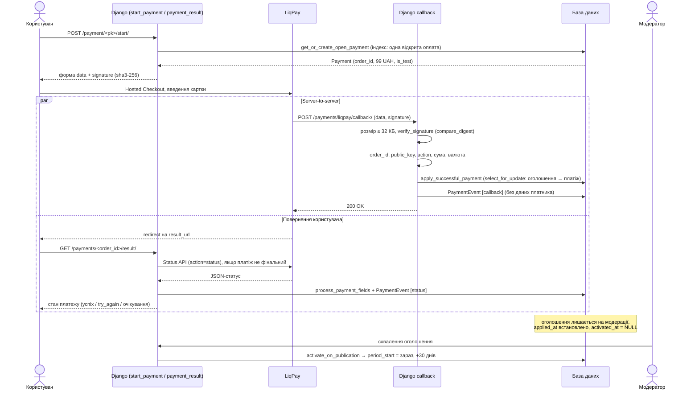

# Звіт про розробку платіжної системи MobiHome

> Підготовлено 19.11.2026, оновлено 22.11.2026 у гілці `stage/liqpay` (HEAD `b4ce42d` + зміни, підготовлені до коміту).
> Документ стосується **лише платежів**: тарифу, LiqPay, зарахування, модерації й активації оплаченого періоду.
> Експлуатаційний посібник (налаштування, розклад синхронізації, ручна перевірка, ввімкнення бойових платежів) —
> [PAYMENTS_OPERATIONS.md](PAYMENTS_OPERATIONS.md).
>
> **Автоматизовані тести ≠ зовнішня перевірка.** Усе, що позначено [Тест], перевірено лише з імітованими
> відповідями LiqPay. Реальні Sandbox-перевірки описано окремо в [розділі 6](#6-реальні-sandbox-перевірки);
> бойові платежі й публічна доступність callback **не перевірялись**.

## Зміст

1. [Джерела та рівні достовірності](#1-джерела-та-рівні-достовірності)
2. [Хронологія роботи](#2-хронологія-роботи)
3. [Як працює оплата LiqPay](#3-як-працює-оплата-liqpay)
4. [Бізнес-логіка платежів](#4-бізнес-логіка-платежів)
5. [Безпека та надійність](#5-безпека-та-надійність)
6. [Реальні Sandbox-перевірки](#6-реальні-sandbox-перевірки)
7. [Автоматизовані тести](#7-автоматизовані-тести)
8. [Як працювати з платіжною системою](#8-як-працювати-з-платіжною-системою)
9. [Поточний стан](#9-поточний-стан)
10. [Що залишилося зробити перед Production](#10-що-залишилося-зробити-перед-production)

---

## 1. Джерела та рівні достовірності

| Позначка | Джерело | Що підтверджує |
|---|---|---|
| **[Git]** | `git log --all --stat`, `git show` для комітів `116ad8a`, `279cab1`, `693b26f`, `b4ce42d` | Які файли й коли змінено |
| **[Сесія]** | Транскрипти двох сесій Claude Code: `8d8016ec…` (15.11.2026) і `e15475bd…` (16–19.11.2026) у `~/.claude/projects/-home-admin-Desktop-mobihome/` | Рішення користувача, звіти, знайдені помилки, проміжні результати тестів. Частина поточної сесії доступна лише як стислий підсумок (контекст було стиснуто) |
| **[Тест]** | Запуск тестів 19.11 і 22.11.2026 на тимчасовій тестовій БД (SQLite без мережі; тимчасовий кластер PostgreSQL 18), відповіді LiqPay імітовано | Поведінка поточного коду |
| **[БД, лише читання]** | `data/db.sqlite3`, відкрита в режимі `mode=ro` | Реальні Sandbox-платежі та події. Виведено лише статуси й дати, без персональних даних і ключів |
| **[Код]** | Поточний код робочої копії | Фактична реалізація |

Недоступно:

- історія роботи над проєктом до 15.11.2026: проєкт тоді не був у Git, а стан на старті зафіксовано в [PROJECT_AUDIT.md](PROJECT_AUDIT.md);
- журнали LiqPay з кабінету мерчанта;
- будь-які production-дані.

### Виправлення попередніх звітів Claude Code

- **Причина пропущених тестів.** У звітах 18–19.11 сказано, що 4 пропущені тести «потребують PostgreSQL». **Це неправда.** Їх пропускає перевірка наявності `.env` у корені проєкту (`A3FailFastTests`, `test_production_refuses_to_start_without_secret_key`).
- **Автор змін у `test_liqpay_hardening.py`.** У кількох звітах сказано, що ці зміни «зробив не я». **Це неправда.** Їх зробив Claude Code у завданні від 19.11.2026 17:14 UTC («тести ідемпотентності та подвійних списань»), яке видно в транскрипті.

---

## 2. Хронологія роботи

Підсумок за кількістю тестів (з повідомлень комітів і звітів сесій):

| Етап | Коміт / стан | Тестів (усього) |
|---|---|---|
| Етап 1: безпека | `e1a0787` | 44 |
| Етапи 3–4: тариф і платежі | `116ad8a` | 79 |
| Період від публікації | `279cab1` | 85 |
| Етап 5: відображення (не платежі) | `6cd00fb` | 105 |
| Етап 2: LiqPay | `693b26f` | 159 |
| A1–A7 | незакомічено → `b4ce42d` | 189 |
| Подвійні списання, `reversed`, review | `b4ce42d` | 215 |
| `try_again` + посилення тестів | незакомічено | 224 |
| Скасування, пізній успіх після EXPIRED | незакомічено | 228 → 229 |
| Різні `order_id`: дослідження → захист | незакомічено | 234 → 242 |
| Точкові виправлення Status API та ALERT | незакомічено | 250 → 257 → 260 → 263 |
| Повний аудит і доопрацювання циклу оплати (22.11) | незакомічено | 263 → 298 |
| `needs_review` для повернення зарахованого платежу (22.11) | незакомічено | 298 → 306 |

### 2.0 Початковий стан (15.11.2026) — [Git `28f2bcd`], [PROJECT_AUDIT.md](PROJECT_AUDIT.md)

**Проблема.** Справжньої оплати не було:

- `PaymentForm` збирав номер картки, термін дії й **CVV** на нашому сервері, а будь-які «валідні» цифри активували платну послугу (C7);
- будь-хто міг «просунути» чуже оголошення (C8);
- кнопка «Опублікувати безкоштовно» сама схвалювала оголошення (C9);
- дві суперечливі ціни: 99 грн / 30 днів і 199 грн / 7 днів (H7);
- кнопка PayPal нічого не робила (H8);
- моделей `Payment` і `Tariff` не було.

### 2.1 Етап 1: прибрати фальшиву оплату — [Git `e1a0787`]

- **Що зроблено:**
  - видалено форму з PAN/CVV, дубль `promote_listing` і шаблон `payment_paid.html`;
  - «безкоштовна публікація» тепер лише надсилає оголошення на модерацію.
- **Файли:** `properties/views.py`, `templates/properties/payment.html`, тести `test_listings_access.py` (`FakePaymentRemovedTests`, `ModerationFlowTests`).
- **Рішення [Сесія 15.11]:** користувач обрав LiqPay з Sandbox і без реальних платежів, ціни — лише після окремого рішення.

### 2.2 Етапи 3–4: тариф і структура платежів — [Git `116ad8a`]

- **Проблема:** немає тарифу й фінансових записів.
- **Рішення користувача [Сесія 15.11, 09:02]:**
  - тариф «Розміщення квартири», 99 грн, 30 календарних днів, одна оплата — одне оголошення;
  - старий ТОП вивести з UI, не видаляючи історії;
  - активне оголошення продовжується від поточної дати завершення.
- **Що зроблено:**
  - модель `Tariff` і міграція [0022_seed_placement_tariff.py](properties/migrations/0022_seed_placement_tariff.py) (99.00 UAH / 30 днів, не перезаписує тариф, змінений адміністратором);
  - модель `Payment`: знімок умов тарифу, фактична сума, валюта й дата, ID транзакції, період, статус;
  - журнал `PaymentEvent`, лише для додавання (міграція [0021](properties/migrations/0021_placement_payments_and_integrity.py));
  - модуль [properties/placement.py](properties/placement.py): зарахування з перевіркою суми й валюти, ідемпотентність;
  - захист фінансових записів: `PROTECT` для оголошення й тарифу, `SET_NULL` + знімок для користувача, видалення оплаченого оголошення замінено архівуванням;
  - адмінка платежів і подій лише для перегляду, керування тарифом;
  - команда `check_data_integrity` (лише читання).
- **Тести:** `TariffTests`, `PlacementPaymentTests`, `FinancialIntegrityTests`, `LegacyTopTests`, `AdminPlacementTests` у [test_placement_admin.py](properties/tests/test_placement_admin.py). Усього 79.

### 2.3 Період від публікації та перехідний період — [Git `279cab1`]

- **Рішення користувача [Сесія 15.11, 10:49]:**
  - 30 днів починаються з **фактичної публікації після модерації**, а не з оплати;
  - прострочене оголошення після оплати чекає модерації;
  - для вже опублікованих оголошень — одноразовий перехідний період 30 днів.
- **Що зроблено:**
  - поле `activated_at` і модель `PlacementTransition` (міграція [0023](properties/migrations/0023_payment_activation_and_transition.py));
  - функція `activate_on_publication` і сигнал [properties/signals.py](properties/signals.py);
  - виклик активації з масових дій адмінки (бо `update()` не надсилає `post_save`);
  - команда [apply_placement_transition](properties/management/commands/apply_placement_transition.py): dry-run за замовчуванням, `--apply` один раз.
- **Тести:**
  - `test_payment_for_new_listing_starts_on_publication`;
  - `test_expired_listing_returns_to_moderation_and_starts_on_republication`;
  - `test_two_payments_before_publication_chain`, `test_rejected_listing_does_not_activate`;
  - `TransitionPeriodTests`.

  Усього 85.

### 2.4 Етап 2: інтеграція LiqPay — [Git `693b26f`, 15.11.2026]

- **Вимоги користувача [Сесія 15.11, 11:20]:**
  - починати без реальних ключів і без HTTPS-сервера;
  - повністю покрити тестами;
  - оплата вимкнена за замовчуванням.
- **Що зроблено** (20 файлів, +1367 / −79):
  - [properties/liqpay.py](properties/liqpay.py): кодування `data`, підпис, Hosted Checkout, обробка callback, Status API;
  - [properties/payment_views.py](properties/payment_views.py): `start_payment`, `liqpay_callback`, `payment_result`, `cancel_payment`;
  - шаблони [liqpay_redirect.html](templates/properties/liqpay_redirect.html) і [payment_result.html](templates/properties/payment_result.html);
  - [properties/checks.py](properties/checks.py), команда [liqpay_sync_pending](properties/management/commands/liqpay_sync_pending.py);
  - `Payment.is_test` (міграція [0024](properties/migrations/0024_payment_is_test.py));
  - два перемикачі: `PAYMENTS_ENABLED` і `PLACEMENT_PAYMENT_REQUIRED`.
- **Технічні рішення:**
  - **SHA3-256 + version 7.** Специфікація LiqPay вимагає `base64(sha3-256(private+data+private))`, хоча приклади коду й SDK досі використовують SHA-1 / v3. Обидва параметри налаштовуються, але активний лише один.
  - **Відповідь Status API не підписана** (звичайний JSON). Тому перевіряється TLS-сертифікат і звіряються `public_key`, `order_id`, сума й валюта. Якщо відповідь прийде з `data` і `signature`, підпис теж перевіряється.
  - **Статус `sandbox`** зараховується лише в тестовому режимі й лише для тестового платежу.
  - **Повернення на `result_url` оплату не підтверджує.**
- **Тести:** +54 (`test_liqpay.py`), усього 159.

### 2.5 Аудит A1–A7 і виправлення — [Сесія 15–18.11], увійшло в [Git `b4ce42d`]

Аудит перед Sandbox-тестами [Сесія 15.11, 11:35] знайшов 7 проблем. Підробленої оплати чи пониження успішної серед них не було.

| # | Проблема | Рішення / виправлення |
|---|---|---|
| A1 | `fetch_status` не ловив `RemoteDisconnected`, `IncompleteRead`, `ConnectionResetError`: сторінка результату давала 500, а `liqpay_sync_pending` зупинялась | Перехоплюються `OSError`, `http.client.HTTPException`, `ValueError`; команда обробляє кожен платіж окремо |
| A2 | Кожен callback із неправильним підписом писав у журнал дані нападника без ліміту (50 запитів → 50 рядків по ~200 КБ) | Ліміт тіла 32 КБ; для недійсного підпису — лише мінімальний запис; ліміт 20 запитів на IP за 600 с і не більше 50 записів у журнал |
| A3 | Перевірки конфігурації не працювали під gunicorn: `PLACEMENT_PAYMENT_REQUIRED=True` без оплати тихо ховав каталог | Fail-fast у `settings.py` через [payment_config.py](properties/payment_config.py): при `DEBUG=False` запуск зупиняється з `ImproperlyConfigured` |
| A4 | `verify_signature` мовчки відкидав не-ASCII символи підпису | Не-ASCII підпис відхиляється |
| A5 | Для одного оголошення можна відкрити кілька оплат: 2 × 99 грн і 60 днів | **Рішення користувача:** одна незавершена оплата на оголошення. Частковий унікальний індекс `one_open_payment_per_property` ([0025](properties/migrations/0025_one_open_payment_per_property.py)) і екран «продовжити / скасувати» |
| A6 | Адміністратор міг оплатити чуже оголошення | Платити може лише власник (`can_pay_for`) |
| A7 | Приймалась пара v7 + sha1 | Дозволено лише (7, sha3_256) і (3, sha1) |

**Інцидент [Сесія 15.11].** Під час аудиту Claude Code помилково надіслав **3 запити Status API на справжній LiqPay** без заглушки. У запитах були фіктивний ключ `sandbox_…` і тестовий `order_id`, персональних даних не було. Подальші проби запускались із вимкненою мережею.

Помилки під час виправлень [Сесія, підсумок] і як їх усунуто:

| Помилка | Причина | Виправлення |
|---|---|---|
| Паралельний тест зависав | `Barrier` без тайм-ауту + паралельний `force_login` на SQLite | Послідовні логіни, `barrier.wait(timeout=30)` |
| `TransactionTestCase` видаляв тариф з міграції 0022 | flush після тесту | `serialized_rollback = True` |
| `check_data_integrity` падав на PostgreSQL | порівняння boolean з `= 1` | `TRUE` / `FALSE` |
| «Продовжити оплату» зсувало `expired_date` | термін рахувався від «зараз» | Від `payment.created_at` |
| Блокування нової оплати заважало продовженню під час гонки | блокувались і відкриті статуси | Блокуються лише закриті (`cancelled`, `failure`, `expired`) на `TTL + 30` хв (`new_payment_blocked_until`) |

Перевірка: усього 189 тестів, серед них паралельне створення платежів і паралельні callback (`ConcurrentPaymentCreationTests`, `ParallelCallbackTests`). Окремо — тимчасовий кластер PostgreSQL 18.

### 2.6 Друге списання за тим самим `order_id`, `reversed`, адмін-перевірка — [Git `b4ce42d`, 18.11.2026]

- **Проблема [Сесія 18.11, 14:45].** Кожне «Продовжити» формує підписаний checkout з тим самим `order_id`. Документація LiqPay **не гарантує**, що одне замовлення неможливо оплатити двічі. Тож другий `success` з іншим `payment_id` міг лишитися непомітним.
- **Що зроблено:**
  - **Друге списання.** `apply_successful_payment` під `select_for_update`: той самий `payment_id` — тихий повтор, інший — не зараховується, ставиться `needs_review=True` і подія `[ALERT duplicate_charge]`, викидається `DuplicateChargeError`. Поле `needs_review` — міграція [0026](properties/migrations/0026_payment_needs_review.py).
  - **`reversed`.** Повернення **другого** `payment_id` не змінює зарахований платіж: `[ALERT duplicate_refund]`, `needs_review`. Повернення першого переводить платіж у `reversed`, але період автоматично не скасовує.
  - **Адмін-дія «Позначити перевіреним»:** дозвіл `review_payment` ([0027](properties/migrations/0027_payment_review_permission.py)), сторінка підтвердження [confirm_review.html](templates/admin/properties/payment/confirm_review.html), подія `[REVIEW closed]`, `LogEntry`. Змінюється лише `needs_review`; якщо поки адміністратор читав сторінку з'явився новий ALERT, перевірка не закривається.
- **Помилки:**
  - перша версія перевірки дублікатів працювала у двох транзакціях (можлива гонка) — переписано під один `select_for_update` (`_credit_locked`);
  - SQLite повертав JSON-значення як int — тести порівнюють payload у Python.
- **Тести:**
  - `DuplicateChargeTests`, `ParallelDuplicateChargeTests`;
  - `DuplicateReversedTests`, `ParallelSuccessReversedTests`;
  - `AdminReviewActionTests`, `ParallelReviewCloseTests`.

  Коміт містить рівно 18 файлів, усього 215 тестів.

### 2.7 Підготовка Sandbox — [Сесія 18.11, 15:04]

- **Що з'ясовано:**
  - `PAYMENTS_ENABLED=True` потрібен лише в окремому Sandbox-середовищі;
  - Sandbox-налаштування в `.env` з порожніми ключами ламали тести й `manage.py`.
- **Що зроблено:**
  - створено ігнорований Git файл `.env.sandbox` (права 600) з окремою БД `data/sandbox.sqlite3`;
  - рекомендовано тунель `cloudflared`;
  - сухий прогін з фіктивними ключами підтвердив `server_url`, `result_url`, `expired_date` і відмову для підробленого підпису.
- **Код не змінювався.**

### 2.8 Обробка `try_again` — [Сесія 18.11, 16:07], незакомічено

- **Проблема (виявлено в реальному Sandbox, див. [розділ 6](#6-реальні-sandbox-перевірки)):**
  - `try_again` не оброблявся: `_handle_other_status` повертав `unknown_status`;
  - сторінка результату нескінченно показувала «Очікуємо підтвердження» й оновлювалась кожні 10 с.
- **Що зроблено:**
  - окрема гілка `TRY_AGAIN_STATUS`: платіж не зараховується й лишається відкритим (із `pending` повертається в `created` умовним UPDATE);
  - `last_attempt_try_again()`; ознаки `try_again` / `can_retry` у `payment_result`;
  - кнопка «Спробувати ще раз» з тим самим `order_id` у межах TTL.
- **Тести:** `TryAgainTests` (9).

### 2.9 Посилення тестів ідемпотентності — [Сесія 19.11, 17:14], незакомічено

Нових тестів не додано: сценарії вже були в `DuplicateChargeTests` і `DuplicateReversedTests`. Три тести посилено перевіркою повного фінансового стану (`finance()`: статус, ID транзакції, сума, `period_end`, `applied_at`). Production-код не змінювався.

### 2.10 Скасування та пізній успіх після EXPIRED — [Сесія 19.11], незакомічено

- `CancelPaymentTests`: чужий користувач → 404, GET → 405, повторне скасування нічого не змінює, успішний платіж скасувати не можна.
  - Помилка була в самому тесті: повідомлення першого скасування не прочитане. Виправлено через `follow=True`.
- `test_expired_payment_late_success_still_credited`: пізній `success` після EXPIRED зараховується один раз.
- Виявлено ризик: **два успішні платежі з різними `order_id`** за одне оголошення давали +60 днів без жодної позначки.

### 2.11 Подвійна оплата різних `order_id` — [Сесія 19.11], незакомічено

- **Дослідження.** Тести показали фактичну поведінку:
  - обидва платежі зараховано, +60 днів, `needs_review` немає;
  - бажаний тест позначено `expectedFailure`.
- **Причина.** `start_payment` закривав прострочену оплату через `expire_stale()` **без запиту статусу** до LiqPay. Тож оплачений платіж із загубленим callback ставав EXPIRED, і користувач платив удруге.
- **Погоджено два рівні захисту** (варіант «не зараховувати другий» відхилено):
  1. **Status API перед EXPIRED.** `is_stale()` і `expire_if_confirmed()` закривають платіж лише після відповіді `not_found` або `try_again`. Мережеві помилки, недійсні відповіді, «ще обробляється» чи невідомий статус лишають платіж відкритим, і нова оплата не створюється. Те саме в `liqpay_sync_pending`.
  2. **Виявлення між різними Payment.** `_cross_order_duplicates()` і `_flag_property_duplicates()`: обидва платежі зараховуються, обидва отримують `needs_review=True` і подію `[ALERT duplicate_property_charge]`.
- **Конкурентність.** `apply_successful_payment` тепер блокує **спершу оголошення, потім платіж** — той самий порядок, що в `activate_on_publication`. Інакше оновлення `needs_review` іншого платежу могло дати deadlock.
- **Перевірка:** паралельний тест на PostgreSQL 18 п'ять разів поспіль — OK.

### 2.12 Точкові виправлення після review — [Сесія 19.11], незакомічено

| Проблема | Виправлення | Тести |
|---|---|---|
| Будь-який `result=error` без коду вважався «не знайдено» і закривав платіж | «Не знайдено» лише за `err_code == "payment_not_found"`, інакше `api_error` | `test_status_api_error_without_not_found_code_keeps_payment` |
| Два ALERT на одну пару; поле `payment_id` неоднозначне | Одна подія на платіж пари, оновлення на місці; окремі `payment_record_id` і `liqpay_payment_id` | `test_alert_updated_in_place_when_second_transaction_becomes_known` |
| Оновлення ALERT на місці обходило захист адмін-дії (той самий id) | `_latest_alert_id()` повертає id + SHA-256-відбиток вмісту | `test_admin_cannot_close_review_with_stale_alert_version` |
| Однаковий `created_at` ховав пару | Порядок `(created_at, pk)` | `test_same_created_at_*`, `CrossOrderBoundaryTests` |
| Межа `applied_at == created_at` | Обрано `>=` (позначати двозначний випадок); мутаційна перевірка підтвердила, що тест ловить `>` | `test_older_applied_exactly_at_newer_created_is_flagged` |
| `payment_not_found` з чужими `order_id` / `public_key` закривав платіж | Присутні поля мають збігатися | `test_not_found_with_foreign_order_id_or_public_key_keeps_payment` |
| `hmac.compare_digest` кидав `TypeError` на не-ASCII | `_same_ascii()`: не рядок або не-ASCII вважається розбіжністю | `test_not_found_with_non_ascii_or_wrong_type_fields_keeps_payment` |
| Внутрішній ALERT мав `signature_valid=True` і `provider_status="success"`, тому ховав `try_again` відкритого платежу | `signature_valid=False`, порожній `provider_status` | `test_property_alert_does_not_hide_try_again_of_open_payment` |
| `re.sub()` перетворював `payment_not_found!` на `payment_not_found` | Порівнюється сире значення без нормалізації | `test_err_code_not_exact_does_not_confirm` (13 значень), `test_start_payment_with_bad_err_code_keeps_old_payment` |
| Текст попередження в адмінці згадував лише один `order_id` | Новий текст охоплює обидва типи подвійного списання | `DuplicateChargeTests.test_admin_sees_warning` |
| Докстрінг `PaymentEvent` («лише додавання») неточний | Описано виняток для `duplicate_property_charge` і семантику `signature_valid` | — |

Перші три тести-«мутанти» на старому коді падали, зокрема з тим самим `TypeError`, тож нові тести справді ловлять ці дефекти.

### 2.13 Повний аудит і доопрацювання циклу оплати — [Сесія 22.11], незакомічено

- **Аудит** усього циклу (checkout → callback → Status API → синхронізація → зарахування → модерація → UI → адмінка) показав, що основна логіка вже була. Знайдено й виправлено такі прогалини:

| Проблема | Виправлення | Файл |
|---|---|---|
| `_rejection_reason` порівнював `public_key` через `hmac.compare_digest(str(...))`: не-ASCII значення давало `TypeError` (500) | `_same_ascii()`: не рядок або не-ASCII — розбіжність, повідомлення відхиляється | `liqpay.py` |
| Сума `sNaN` у підписаному повідомленні кидала `InvalidOperation` при порівнянні; `NaN`/`Infinity` не відкидались явно | `_parse_amount()`: лише скінченні `Decimal`, інакше «некоректна сума» | `liqpay.py` |
| LiqPay підтвердив іншу суму/валюту: платіж лише отримував `pending` + `error_message`, адміністратора ніщо не сповіщало; сторінка результату вічно оновлювалась і показувала внутрішній текст | `needs_review=True` і **одна** подія `[ALERT amount_mismatch]` на кожну комбінацію `payment_id`+сума+валюта; окремий стан «Оплата потребує ручної перевірки» без автооновлення і без «Скасувати»; користувач не може скасувати такий платіж | `placement.py`, `payment_views.py`, `payment_result.html` |
| Загублений callback для платежу, скасованого користувачем (оплаченого в іншій вкладці), ніколи не відновлювався: `liqpay_sync_pending` опитувала лише `created`/`pending` | Команда опитує також незараховані `cancelled`/`expired`, молодші за `TTL + 30` хв; успіх зараховується, інші відповіді закритий платіж не змінюють | `liqpay_sync_pending.py` |
| Синхронізація без паузи між запитами і без зупинки при недоступності LiqPay | `--delay` (0,5 с), `--max-failures` (5 помилок мережі/API поспіль → зупинка, код виходу 1, платежі не змінено) | `liqpay_sync_pending.py` |
| Сторінка успішної оплати не пояснювала, чому розміщення ще не почалося | Окремі тексти: чернетка (надіслати на модерацію), на модерації, відхилено (з коментарем модератора), в архіві | `payment_result.html` |
| В історії не видно номера замовлення; можна було випадково оплатити вдруге ще не опубліковане оголошення | Номер замовлення в історії профілю; попередження «нова оплата додасть ще 30 днів» | `profile.html`, `payment.html` |
| В адмінці в списку платежів не видно ID транзакції та часу оновлення | Додано `provider_transaction_id`, `updated_at`; текст попередження охоплює всі причини `needs_review` | `admin.py` |

- **Нові тести:** модуль [test_payment_lifecycle.py](properties/tests/test_payment_lifecycle.py) — 35 тестів (валідація полів, невідповідність суми, стани сторінки результату, бізнес-сценарії модерації, відновлення синхронізацією).
- **Документація:** [PAYMENTS_OPERATIONS.md](PAYMENTS_OPERATIONS.md).
- **Без міграцій**, без змін тарифу (99 UAH / 30 днів) і правил періоду.

### 2.14 Повернення коштів за зарахованим платежем — [Сесія 22.11], незакомічено

- **Рішення користувача [Сесія 22.11]:** `reversed` для **зарахованого** платежу має ставити `needs_review` і створювати рівно одну подію `[ALERT payment_reversed]`. До цього повернення лише переводило платіж у `reversed` без позначки (правило, зафіксоване тестом `test_reversed_of_first_payment_id_follows_refund_rules`; тест оновлено відповідно до нового рішення: `assertFalse(needs_review)` → `assertTrue`).
- **Реалізація** (`mark_reversed`, `_flag_reversed` у [placement.py](properties/placement.py)):
  - під наявним `select_for_update` рядка платежу: подія створюється, лише якщо її ще немає — повтори callback, відповіді Status API і паралельні повідомлення не дублюють її;
  - `needs_review=True` ставиться лише разом зі створенням події, тож повтор після закриття перевірки адміністратором її **не відкриває знову**;
  - внутрішня подія застосунку: `signature_valid=False`, порожній `provider_status`; payload — `type`, `property_id`, `payment_record_id`, `order_id`, `liqpay_payment_id`, `reversed_payment_id`, `amount`, `currency` (без даних платника);
  - дані зарахування (`provider_transaction_id`, сума, дати, період) і оголошення (публікація, модерація, `placement_until`) не змінюються;
  - повернення **незарахованого** платежу: як і раніше `reversed`, без `needs_review` і без події;
  - повернення **іншого** `payment_id` (друге списання) — без змін: `[ALERT duplicate_refund]`.
- **Тести:** `ReversedPaymentReviewTests` (7), `ConcurrentReversedTests` (1, 4 потоки).

---

## 3. Як працює оплата LiqPay

### 3.1 Покроково

1. **Створення платежу.**
   - Власник на `/payment/<pk>/` натискає «Оплатити» → `POST /payment/<pk>/start/` (`start_payment`).
   - Перевіряється: увійшов, власник (`can_pay_for`, інакше 404), `payments_active()`.
   - Якщо незавершена оплата вже є, вона продовжується. Якщо вона прострочена — спершу запит Status API (див. 3.4).
   - Ліміт: 10 нових платежів на користувача за годину.
   - `get_or_create_open_payment` створює `Payment` з `order_id = mh-<id>-<20 hex>` і знімком тарифу. Паралельні запити зупиняє індекс `one_open_payment_per_property`, і вони отримують наявну оплату.
2. **Підпис.** `build_checkout()` бере суму, валюту й опис **лише з запису в БД** і додає `expired_date` = `created_at` + `LIQPAY_PAYMENT_TTL_MINUTES`.
   - `data = base64(json)`;
   - `signature = base64(sha3_256(private_key + data + private_key))` (`make_signature`).
3. **Перехід на Hosted Checkout.** [liqpay_redirect.html](templates/properties/liqpay_redirect.html) автоматично надсилає форму з `data` і `signature` на `https://www.liqpay.ua/api/3/checkout`. Дані картки вводяться лише на сторінці LiqPay.
4. **Callback (server-to-server).** LiqPay надсилає `POST /payments/liqpay/callback/` (`liqpay_callback` → `handle_callback` → `process_payment_fields`).
5. **Повернення користувача.** LiqPay повертає користувача на `result_url` (`payment_result`). Сторінка **нічого не підтверджує** з параметрів запиту: показує стан із БД і для незавершеного платежу робить `fetch_status()` (не частіше разу на 10 с).
6. **Зарахування й модерація.**
   - `apply_successful_payment()` зараховує платіж (`applied_at`) і застосовує правила строків (розділ 4).
   - Оголошення не публікується: період стартує після схвалення модератором через `activate_on_publication`.

### 3.2 Діаграма



### 3.3 Справжність callback

| Крок | Перевірка | Результат при порушенні |
|---|---|---|
| 1 | `CONTENT_LENGTH` ≤ 32 КБ | 413 |
| 2 | `verify_signature`: рядки, не порожні, ASCII, дозволена пара версії й алгоритму, `hmac.compare_digest` | 400; мінімальний запис (причина, розмір) у межах ліміту; при перевищенні 429 |
| 3 | `decode_data`: валідний base64 і JSON-об'єкт | 400, подія «Некоректний формат data» |
| 4 | Відомий `order_id`, `public_key` збігається, `action ∈ {None, "pay"}` | 200 (щоб LiqPay не повторював), подія з причиною, без змін платежу |
| 5 | Для `success` / `sandbox`: режим, `is_test`, скінченна сума, сума й валюта | Не зараховується (тестовий у бойовому; некоректна сума — подія; невідповідність суми → `pending` + `error_message` + `needs_review` + `[ALERT amount_mismatch]`) |

### 3.4 Status API і відсутній callback

`fetch_status()` надсилає підписаний `action=status` на `https://www.liqpay.ua/api/request` і звіряє відповідь з нашим записом.

Коли викликається:

- **Сторінка результату:** якщо платіж не фінальний.
- **`start_payment`:** якщо відкрита оплата старша за `TTL + 30` хв (`is_stale`). Результат `expire_if_confirmed`:

  | Відповідь | Дія |
  |---|---|
  | `success` | зарахувати, редирект на результат, новий платіж не створюється |
  | `failure` / `error` | FAILURE, далі можна створити нову оплату |
  | `payment_not_found` / `try_again` | EXPIRED, далі можна створити нову оплату |
  | у обробці (`wait_*`, `*_verify`…) | лишити відкритим, нову оплату не створювати |
  | мережа, недійсна відповідь, чужий `order_id` / `public_key`, інший `err_code`, невідомий статус | нічого не закривати, повідомлення «Не вдалося підтвердити стан… нову оплату не створено» |

- **`liqpay_sync_pending`:** для всіх незавершених платежів, старших за `--min-age` хв, за тими самими правилами, а також для незарахованих `cancelled`/`expired`, молодших за `TTL + 30` хв (відновлення загубленого callback). Пауза `--delay` між запитами; після `--max-failures` помилок мережі/API поспіль — зупинка з кодом виходу 1 без змін платежів. Уже зараховані платежі команда **не опитує**.

### 3.5 Чи можна повторити оплату

| Стан | Повтор |
|---|---|
| `created` у межах TTL | «Продовжити оплату» — той самий `order_id`, `expired_date` не зсувається |
| `created` після `try_again` у межах TTL | «Спробувати ще раз» — той самий `order_id` |
| `created` після TTL, але до `TTL + 30` хв | Ні: «Термін форми минув, нову оплату можна створити після …» (3-D Secure ще може завершитись) |
| Відкритий після `TTL + 30` хв | Лише після достовірної відповіді Status API (3.4) |
| `pending` | Ні: «Оплата вже обробляється» |
| `cancelled` / `failure` / `expired` | Нова оплата не раніше ніж через `TTL + 30` хв від створення попередньої (`new_payment_blocked_until`) |
| `success` | Нова оплата = продовження (розділ 4) |

### 3.6 Обробка статусів LiqPay ([properties/liqpay.py](properties/liqpay.py))

| Статус | Обробка |
|---|---|
| `success` | Зарахування через `apply_successful_payment` (ідемпотентно) |
| `sandbox` | Як `success`, але лише при `LIQPAY_SANDBOX=True` і `Payment.is_test=True` |
| `failure`, `error` | `FAILURE` з `err_code` / `err_description`; зарахований платіж не змінюється |
| `try_again` | Відкритий (`created`), без зарахування, можна повторити |
| `reversed` | `REVERSED`; якщо платіж був зарахований — `needs_review` і рівно одна `[ALERT payment_reversed]`; для іншого `payment_id` — `[ALERT duplicate_refund]`, зарахований платіж не змінюється |
| `processing`, `prepared`, `wait_*`, `3ds_verify`, `otp_verify` та інші з `PENDING_STATUSES` | `PENDING`, якщо платіж ще не фінальний |
| Невідомий | Подія «Невідомий статус — без змін» |
| `result=error`, `err_code="payment_not_found"` (Status API) | `not_found`; закриває прострочений платіж, лише якщо присутні `order_id` / `public_key` збігаються |
| `result=error` з іншим або відсутнім `err_code` | `api_error`, нічого не змінюється |

### 3.7 Захист від подвійного списання та зарахування

| Ризик | Захист |
|---|---|
| Повторне натискання, дві вкладки, паралельні запити | Одна відкрита оплата на оголошення (індекс БД), «Продовжити» з тим самим `order_id` |
| Оплата старої форми після створення нової | Блокування нової оплати на `TTL + 30` хв; Status API перед EXPIRED |
| Повторний або паралельний callback | `select_for_update` + умовний UPDATE `applied_at IS NULL`; той самий `payment_id` нічого не змінює |
| Другий `payment_id` для того самого `order_id` | Не зараховується, `needs_review`, `[ALERT duplicate_charge]` |
| Два `order_id`, обидва оплачені | Обидва зараховані, обидва `needs_review`, `[ALERT duplicate_property_charge]` |
| Один `provider_transaction_id` для двох платежів | `IntegrityError` → «транзакція вже прив'язана до іншого платежу» |
| LiqPay підтвердив іншу суму/валюту | Не зараховується, `needs_review`, `[ALERT amount_mismatch]` |
| Повернення коштів за зарахованим платежем | `needs_review`, `[ALERT payment_reversed]` (одна подія); період і оголошення не змінюються |

---

## 4. Бізнес-логіка платежів

Реалізація: `_apply_period_rules`, `_activate`, `activate_on_publication` у [properties/placement.py](properties/placement.py), сигнал у [properties/signals.py](properties/signals.py).

| Сценарій | Фактична поведінка | Тест |
|---|---|---|
| **Вартість** | Тариф `placement`: 99.00 UAH, 30 днів (міграція 0022; у локальній БД підтверджено читанням: `placement, 99, UAH, 30, active`). Платіж зберігає знімок умов; зміна тарифу в адмінці на нього не впливає | `test_placement_tariff_seeded`, `test_tariff_edit_does_not_change_existing_payment` |
| **Нове оголошення, оплата до модерації** | Платіж `success` + `applied_at`, оголошення лишається неопублікованим на модерації, `period_start` порожній — дні не витрачаються | `test_payment_for_new_listing_starts_on_publication`, `test_status_check_success_credits_and_waits_moderation` |
| **Публікація після схвалення** | `activate_on_publication` ставить `period_start = зараз`, `period_end = +30 днів`, `placement_until = period_end` | `test_new_listing_waits_moderation_then_30_days_from_publication` |
| **Повторна активація** | Беруться лише платежі з `activated_at IS NULL` під блокуванням, тож повторне схвалення чи збереження не нараховує період удруге | `test_idempotent_double_processing`, `test_two_payments_before_publication_chain` |
| **Продовження активного** | +30 днів до поточного `placement_until`, без повторної модерації | `test_renewal_of_active_listing_adds_to_current_end`, `test_valid_success_credits_and_extends` |
| **Прострочене оголошення** | Після оплати `approved` → `pending`, 30 днів від повторної публікації | `test_expired_listing_returns_to_moderation_and_starts_on_republication`, `test_expired_listing_returns_to_moderation` |
| **Схвалене, ще не оплачене** | Період від моменту оплати | `test_approved_but_unpaid_listing_starts_at_payment` |
| **Відхилене модератором** | Оплату збережено (`success`), не активується; після схвалення — 30 днів від публікації | `test_rejected_listing_does_not_activate`, `test_paid_rejected_listing_activates_only_after_approval` |
| **Відхилення активного оголошення** | Ховається з каталогу; `placement_until` не змінюється; повторне схвалення днів не додає | `test_rejecting_paid_live_listing_hides_it_and_reapproval_does_not_extend` |
| **Дві оплати до публікації** | Активуються послідовно (60 днів), без `needs_review` | `test_two_payments_before_publication_run_sequentially` |
| **Невдалі, скасовані, прострочені** | Розміщення не продовжують; пізній `failure` не скасовує `success` | `test_failed_cancelled_expired_do_not_extend`, `test_late_failure_does_not_override_success` |
| **Повернення коштів (`reversed`)** | Статус `reversed`; для зарахованого платежу — `needs_review` і одна `[ALERT payment_reversed]`. Період, публікація й модерація **не змінюються автоматично** — рішення адміністратора | `test_reversed_of_first_payment_id_follows_refund_rules`, `ReversedPaymentReviewTests` |
| **Каталог з обов'язковою оплатою** | Лише при `PLACEMENT_PAYMENT_REQUIRED=True`: показуються оголошення з `placement_until > now` (зараз вимкнено) | `test_catalog_requires_active_placement_when_enabled` |

---

## 5. Безпека та надійність

| Механізм | Де | Від чого захищає |
|---|---|---|
| Підпис LiqPay SHA3-256 v7, дозволені лише пари (7, sha3_256) / (3, sha1) | `make_signature`, `ALLOWED_VERSION_ALGORITHMS` | Підробка callback; випадкове ослаблення до SHA-1 через неправильну конфігурацію |
| `hmac.compare_digest` для підпису, `public_key`, `order_id` | `verify_signature`, `_rejection_reason` (через `_same_ascii`), `_same_ascii` | Атаки за часом відповіді; `TypeError` на не-ASCII чи не-рядкових значеннях |
| Ліміт тіла callback 32 КБ | `MAX_CALLBACK_BYTES` | Роздування БД і пам'яті великими запитами |
| Мінімальний запис і ліміт недійсних callback (20 на IP / 600 с, 50 записів у журнал) | `_record_invalid_callback` | Засмічення журналу; реальні callback перевіряються **до** ліміту |
| Перевірка типів і значень | `decode_data`, `_rejection_reason`, суворе `err_code`, `_same_ascii` | Підміна полів, неочікувані типи JSON, коди, що «стають» `payment_not_found` після нормалізації |
| Сума й валюта лише з сервера | `build_checkout`, перевірка в `_credit_locked` | Зміна суми в браузері; оплата меншої суми |
| Ідемпотентне зарахування | `apply_successful_payment`: `select_for_update` + `applied_at IS NULL` | Подвійне +30 днів від повторних або паралельних callback |
| Скінченні суми | `_parse_amount` | `NaN`/`sNaN`/`Infinity` у підписаному повідомленні (виняток або хибне порівняння) |
| Ручна перевірка аномалій | `needs_review` + `[ALERT amount_mismatch]` / `[ALERT payment_reversed]`, одна подія під `select_for_update` | Непомічена оплата з іншою сумою; непомічене повернення коштів |
| Користувач не скасовує платіж із невідповідною сумою | `cancel_payment` | Приховування аномалії, коли кошти, можливо, списано |
| Порядок блокувань «оголошення → платіж» | `apply_successful_payment`, `activate_on_publication` | Deadlock; два зарахування різних `order_id`, які «не бачать» одне одного |
| Унікальність `order_id` і `provider_transaction_id`; частковий індекс однієї відкритої оплати | [models.py](properties/models.py) | Прив'язка однієї транзакції до двох платежів; дві відкриті оплати |
| `CheckConstraint`: сума > 0, термін ≥ 1, коректний період | `Payment.Meta` | Некоректні фінансові записи на рівні БД |
| `needs_review` не знімається callback-ами, Status API чи синхронізацією | `test_needs_review_survives_callbacks_status_api_and_sync` | Тихе зникнення позначки підозрілого платежу |
| Аудит адмін-дій | `[REVIEW closed]` + `LogEntry`, дозвіл `review_payment`, версія ALERT | Неконтрольоване закриття перевірки; закриття після появи нової інформації |
| Платежі в адмінці лише для перегляду | `PaymentAdmin`, `PaymentEventAdmin` | Ручна зміна фінансових записів |
| Rate limiting | 10 платежів на користувача за годину; Status API раз на 10 с на замовлення | Спам платежами; DoS на API LiqPay |
| Секрети | `.env` (ігнорується Git), `LiqPayConfig.__repr__` ховає ключ, приватний ключ не потрапляє в HTML і події (тести) | Витік приватного ключа |
| Події без даних платника | `SAFE_EVENT_FIELDS`, обрізання до 255 символів | Збереження ПІБ, телефону, маски картки |
| Fail-fast production | `startup_problems` у `settings.py`, system checks `E001`–`E003`, `W001` | Запуск із тестовим ключем у бойовому режимі, без `SITE_URL` / HTTPS, з обов'язковою оплатою без оплати |
| Sandbox і Production розділені | `is_test`, статус `sandbox`, префікс ключа | Зарахування тестових оплат у бойовому режимі |
| Повернення на `result_url` нічого не підтверджує | `payment_result` | Підробка «успіху» параметрами URL |

---

## 6. Реальні Sandbox-перевірки

> Це **ручне тестування**, а не автоматичні тести. Джерела: повідомлення користувача **[Сесія]** і записи в `data/db.sqlite3` **[БД, лише читання]**. Час нижче — київський (у БД зберігається UTC). `order_id` скорочено.

Записи в БД:

- 3 тестові платежі (`is_test=1`), усі `success`, 99 UAH, `needs_review=0`;
- 40 подій;
- Sandbox-тести проводились на **основній локальній БД** `data/db.sqlite3`, а не на `data/sandbox.sqlite3` з `.env.sandbox`.

| # | Сценарій | Що підтверджено | Джерело |
|---|---|---|---|
| 1 | **Успішна оплата 99 UAH** | Платіж #1 (`mh-1-0ee…b0c1`): створено 18.11 17:54, оплачено 17:56, зараховано через **callback** (`[callback] Оплату зараховано.`, `signature_valid=1`, `paytype=card`) | [БД] |
| 2 | **Невдала спроба** (за словами користувача — відхилення картки AntiFraud) | Платіж #2 (`mh-2-0f7…8c0b`): Status API повертав `status=try_again`, `err_code=limit`. Події 2–36 (18.11 18:02–18:08) — до виправлення: «Невідомий статус — без змін» кожні ~11 с, тобто нескінченне автооновлення сторінки. Колбеку для `try_again` у журналі немає | [БД], [Сесія 18.11 16:07 UTC] |
| 3 | **Повторна спроба після невдачі** | Події 37–38 (18:08:43, 18:15:53) — вже після виправлення: «Спробу оплати відхилено (try_again) — можна оплатити ще раз» | [БД] |
| 4 | **Успішна оплата після повторної спроби** | Той самий платіж #2 (той самий `order_id`) → `success` через callback 18:17:28 | [БД] |
| 5 | **Відновлення через Status API** | Платіж #3 (`mh-3-41b…8905`): створено 19.11 20:16, оплачено 20:21, зараховано **через Status API** (`[status] Оплату зараховано.`, 20:23). Подій callback для цього платежу **немає**: callback не надійшов або не дійшов (причина невідома — можливо, змінилась адреса тунелю) | [БД] |
| 6 | **Успішна оплата не публікує оголошення** | Усі три оголошення з оплатами: `is_published=0`, `moderation_status=pending`, `placement_until` порожній, `activated_at` порожній | [БД] |
| 7 | **`payment_not_found` через неіснуючий `order_id`** | **Не підтверджено.** У БД немає подій «не знайдено»; результат такої перевірки не зафіксовано | — |
| 8 | **Період починається після схвалення** | **Не перевірено вручну.** Жодне з оплачених оголошень ще не схвалене (усі `pending`). Підтверджено лише автотестами | [Тест] |

Додатково:

- **[Сесія 19.11 17:14]** — користувач згадав «дві вже успішні Sandbox-оплати» (тоді #1 і #2). Платіж #3 з'явився пізніше.
- **Тестові картки.** Який саме номер картки використовувався в кожній спробі, **у БД не зберігається** (і це правильно: маска картки не пишеться в журнал). В Етапі 2 Claude Code посилався на картки з офіційної сторінки LiqPay «Тестування»: успіх `4242…4242`, 3-D Secure `4000…3063`, відмова з кодом `limit` `4000…0002`. Те, що спроба #2 дала саме `err_code=limit`, **узгоджується** з карткою відмови, але **не доводить**, що використовувалась саме вона.
- **Не виконувались:** реальне повернення коштів (`reversed`), оплата у двох вкладках, обов'язкова оплата в каталозі.
- **Зміни 22.11 (розділи 2.13–2.14) у Sandbox не перевірялись:** невідповідність суми, `[ALERT payment_reversed]`, відновлення скасованого платежу синхронізацією, нові тексти сторінки результату. Вони підтверджені лише автотестами з імітованими відповідями LiqPay.

---

## 7. Автоматизовані тести

### 7.1 Результат запуску (22.11.2026)

Тимчасова тестова БД, venv проєкту, `--settings=config.test_settings`, усі відповіді LiqPay імітовано. Локальна БД не змінювалась.

| Модуль | Тестів | Результат |
|---|---|---|
| [test_liqpay.py](properties/tests/test_liqpay.py) | 102 | OK |
| [test_liqpay_hardening.py](properties/tests/test_liqpay_hardening.py) | 56 | OK, 3 пропущено (`A3FailFastTests` через наявний `.env`) |
| [test_placement_admin.py](properties/tests/test_placement_admin.py) | 41 | OK |
| [test_payment_lifecycle.py](properties/tests/test_payment_lifecycle.py) | 43 | OK |
| **Разом платіжні модулі** | **242** | **OK (3 пропущено)** |
| **Увесь проєкт, SQLite** (`unshare -rn venv/bin/python manage.py test --settings=config.test_settings`) | **306** | **OK (4 пропущено)** |
| **Увесь проєкт, тимчасовий PostgreSQL 18** | **306** | **OK (4 пропущено)** |
| Тести конкурентності (`-k parallel -k Parallel -k Concurrent -k concurrent`), 3 прогони на кожній БД | 7 | OK щоразу |

- **Пропущені 4 тести** — через наявний `.env` (`A3FailFastTests` ×3, `test_production_refuses_to_start_without_secret_key`), а не через PostgreSQL.
- **Мережа:** у прогонах 22.11 `urllib.request.urlopen` замінювався заглушкою, що фіксує кожну спробу; зафіксовано **0** спроб реального запиту.
- **`manage.py test --parallel`** не використовувався: на SQLite з Python 3.14 (`forkserver`) Django не підтримує клонування БД, на PostgreSQL запуск зависав і був зупинений. На результати це не впливає: «паралельні» тести вище — це справжні потоки всередині одного тесту.
- PostgreSQL-результати отримано на тимчасовому кластері (зупинено після прогону) з окремим venv з `psycopg`; без нього вони не відтворюються.

### 7.2 Тести за категоріями

**Checkout**

- `CheckoutTests`: `test_start_payment_builds_signed_checkout_with_server_amount`, `test_unique_order_ids`, `test_only_owner_can_pay`, `test_get_not_allowed`, `test_disabled_creates_nothing`, `test_not_active_without_keys`, `test_payment_page_shows_pay_button`, `test_rate_limit`
- `A5A6OpenPaymentAndOwnerTests`: `test_resume_does_not_extend_checkout_expiry`, `test_resume_after_form_expired_gives_no_checkout`, `test_admin_cannot_pay_foreign_listing`, `test_owner_id_from_form_is_ignored`, `test_admin_can_pay_own_listing`, `test_listing_without_owner_cannot_be_paid`

**Підписування та callback**

- `SignatureTests`: `test_sha3_256_matches_spec_formula`, `test_sha1_only_when_configured`, `test_wrong_or_malformed_signatures_rejected`, `test_uses_constant_time_compare`, `test_private_key_never_in_repr`
- `A4StrictSignatureTests.test_non_ascii_in_signature_rejected`
- `A7VersionAlgorithmTests`: `test_only_allowed_pairs`, `test_mismatched_pair_never_signs_or_verifies`
- `CallbackTests`: `test_callback_is_csrf_exempt`, `test_forged_signature_rejected`, `test_tampered_data_with_old_signature_rejected`, `test_missing_fields_and_garbage`, `test_signed_but_not_json_data`, `test_wrong_amount_and_currency_not_credited`, `test_unknown_order_id`, `test_foreign_public_key_not_credited`, `test_unexpected_action_not_credited`, `test_event_payload_has_no_payer_details`, `test_payment_cannot_credit_another_listing`
- `A2CallbackAbuseTests`: `test_oversized_callback_rejected_without_db_write`, `test_invalid_signature_stored_minimally`, `test_garbage_order_id_not_stored`, `test_rate_limit_per_ip_and_global_db_cap`, `test_valid_callback_processed_even_when_ip_is_limited`, `test_valid_event_values_truncated`
- `ProductionModeTests`: `test_sandbox_status_rejected_in_production`, `test_test_payment_not_credited_in_production`, `test_live_success_credited`, `test_sandbox_key_in_production_is_config_error`
- `ConfigChecksTests` (4), `A3FailFastTests` (3)

**Status API**

- `ResultUrlAndStatusTests`: `test_return_without_callback_does_not_confirm`, `test_status_check_pending`, `test_status_check_success_credits_and_waits_moderation`, `test_status_check_rejects_mismatches`, `test_status_signed_response_verified`, `test_network_error_changes_nothing`, `test_status_check_throttled`, `test_expire_stale_and_sync_command`
- `A1StatusNetworkErrorsTests`: `test_http_level_errors_are_handled`, `test_result_page_survives_network_error`, `test_non_dict_response_ignored`, `test_sync_command_continues_after_unexpected_error`
- `CallbackTests`:
  - `test_status_api_errors_do_not_expire_or_create_new_payment`, `test_status_api_pending_keeps_old_payment_and_no_new_one`, `test_status_api_success_credits_old_payment_and_no_new_one`, `test_status_api_failure_closes_and_allows_new_payment`, `test_status_api_try_again_after_hold_expires_and_allows_new_payment`;
  - `test_status_api_payment_not_found_expires_and_allows_new_payment`, `test_status_api_error_without_not_found_code_keeps_payment`;
  - `test_not_found_with_matching_or_absent_fields_expires`, `test_not_found_with_foreign_order_id_or_public_key_keeps_payment`, `test_not_found_with_non_ascii_or_wrong_type_fields_keeps_payment`;
  - `test_err_code_exact_payment_not_found_confirms`, `test_err_code_not_exact_does_not_confirm`, `test_start_payment_with_bad_err_code_keeps_old_payment`;
  - `test_sync_command_network_error_does_not_expire`, `test_sync_command_generic_api_error_does_not_expire`

**Повторні callback**

- `CallbackTests.test_repeated_callback_is_idempotent`
- `DuplicateChargeTests.test_same_payment_id_repeat_is_idempotent`
- `A5A6OpenPaymentAndOwnerTests.test_paid_order_id_is_credited_once`
- `TryAgainTests.test_late_success_credited_once`
- `CallbackTests.test_two_order_ids_repeated_callbacks_add_nothing`
- `PlacementPaymentTests.test_idempotent_double_processing`

**Подвійне зарахування**

- `CallbackTests`: `test_two_order_ids_late_a_flags_immediately`, `test_two_order_ids_late_a_then_b_both_flagged`, `test_two_order_ids_b_then_late_a_both_flagged`, `test_two_order_ids_transaction_ids_and_events_kept`, `test_normal_extension_after_success_not_flagged`, `test_same_created_at_late_a_then_b_flagged`, `test_same_created_at_b_then_a_flagged`, `test_expired_payment_late_success_still_credited`
- `CrossOrderBoundaryTests`: `test_older_credited_before_newer_created_is_normal_extension`, `test_older_applied_exactly_at_newer_created_is_flagged`, `test_older_credited_after_newer_created_is_flagged`, `test_same_created_at_ordered_by_pk`, `test_normal_extension_through_callbacks_not_flagged`
- `A5A6OpenPaymentAndOwnerTests`: `test_repeated_click_reuses_open_payment`, `test_db_constraint_blocks_second_open_payment`, `test_get_or_create_handles_race_via_integrity_error`

**Повторні транзакції**

- `DuplicateChargeTests`: `test_other_payment_id_after_success_is_flagged_not_credited`, `test_repeated_second_payment_id_creates_single_alert`, `test_second_charge_via_status_api_is_flagged_too`
- `DuplicateReversedTests`: `test_reversed_of_second_payment_id_keeps_first_payment_intact`, `test_repeated_reversed_of_second_payment_id_single_event`, `test_reversed_via_status_api`
- `PlacementPaymentTests.test_same_transaction_id_cannot_pay_twice`
- `CallbackTests`: `test_alert_updated_in_place_when_second_transaction_becomes_known`, `test_property_alert_is_internal_event_not_provider_message`

**Невдалі платежі та скасування**

- `CallbackTests`: `test_failure_error_pending_statuses`, `test_pending_after_failure_does_not_reopen`, `test_late_failure_after_success_ignored`, `test_reversed`
- `TryAgainTests` (9): `test_try_again_keeps_payment_open_and_not_credited`, `test_try_again_after_pending_reopens_for_retry`, `test_result_page_shows_retry_not_endless_waiting`, `test_retry_reuses_same_order_id_within_ttl`, `test_retry_hidden_after_ttl`, `test_late_success_via_status_api`, `test_no_retry_for_final_statuses`, `test_failure_still_final`
- `CallbackTests.test_property_alert_does_not_hide_try_again_of_open_payment`
- `CancelPaymentTests`: `test_other_user_gets_404_and_payment_unchanged`, `test_get_not_allowed`, `test_repeat_cancel_is_noop`, `test_cannot_cancel_successful_payment`
- `ResultUrlAndStatusTests.test_cancel_then_late_success_still_credited`
- `A5A6OpenPaymentAndOwnerTests`: `test_cancel_blocks_new_payment_while_old_form_is_payable`, `test_failed_payment_blocks_new_one_until_window_ends`, `test_stale_open_payment_expires_and_is_replaced`, `test_test_payment_closed_when_mode_changes`, `test_mismatch_payment_does_not_block_new_one`, `test_pending_payment_is_not_reopened`
- `PlacementPaymentTests`: `test_failed_cancelled_expired_do_not_extend`, `test_late_failure_does_not_override_success`, `test_amount_or_currency_mismatch_not_applied`

**Модерація**

- `PlacementBusinessFlowTests`: `test_new_listing_waits_moderation_then_30_days_from_publication`, `test_expired_listing_returns_to_moderation`, `test_catalog_visibility_follows_payment`
- `PlacementPaymentTests`: `test_payment_for_new_listing_starts_on_publication`, `test_rejected_listing_does_not_activate`
- `ResultUrlAndStatusTests.test_status_check_success_credits_and_waits_moderation`

**Активація та продовження**

- `PlacementPaymentTests`: `test_first_payment_gives_30_days_and_records_details`, `test_renewal_of_active_listing_adds_to_current_end`, `test_expired_listing_returns_to_moderation_and_starts_on_republication`, `test_two_payments_before_publication_chain`, `test_approved_but_unpaid_listing_starts_at_payment`, `test_catalog_requires_active_placement_when_enabled`, `test_catalog_unchanged_while_flag_off`
- `CallbackTests.test_valid_success_credits_and_extends`
- `TransitionPeriodTests`: `test_dry_run_changes_nothing`, `test_apply_once_only_touches_placement`, `test_after_transition_ends_payment_is_required`
- `TariffTests`: `test_placement_tariff_seeded`, `test_tariff_edit_does_not_change_existing_payment`, `test_tariff_with_payments_cannot_be_deleted`
- `PlacementPaymentTests`: `test_create_payment_snapshot_and_owner_only`, `test_inactive_tariff_cannot_be_used`

**Адміністративна перевірка**

- `AdminReviewActionTests` (8): `test_action_visible_only_with_permission`, `test_direct_post_without_permission_is_403`, `test_plain_staff_without_any_payment_permission_is_denied`, `test_confirmation_page_shows_order_status_and_alerts`, `test_close_review_keeps_finance_and_alerts_and_writes_audit`, `test_repeated_close_creates_no_duplicates`, `test_not_flagged_payment_cannot_be_closed`, `test_new_alert_after_confirmation_page_blocks_close`
- `CallbackTests`: `test_alert_update_changes_admin_review_version`, `test_admin_cannot_close_review_with_stale_alert_version`
- `DuplicateChargeTests`: `test_admin_sees_warning`, `test_no_warning_without_duplicates`
- `DuplicateReversedTests.test_needs_review_survives_callbacks_status_api_and_sync`
- `AdminPlacementTests`: `test_payment_admin_is_view_only`, `test_payment_search_and_filter`, `test_tariff_admin_edit`, `test_paid_listing_admin_delete_is_refused`

**Цикл оплати 22.11** ([test_payment_lifecycle.py](properties/tests/test_payment_lifecycle.py))

- `CallbackFieldValidationTests`: `test_non_finite_amount_rejected_without_crash`, `test_non_ascii_or_non_string_public_key_rejected`, `test_unknown_order_does_not_create_payment`, `test_order_id_substitution_credits_only_named_order`
- `AmountMismatchReviewTests`: `test_mismatch_flags_review_with_single_alert`, `test_currency_mismatch_and_new_amount_add_separate_alerts`, `test_status_api_repeat_does_not_duplicate_alert`, `test_result_page_shows_manual_review_without_refresh_or_cancel`, `test_owner_cannot_cancel_mismatched_payment`, `test_admin_warning_mentions_mismatch`, `test_correct_success_after_mismatch_still_not_auto_credited_twice`
- `ResultPageStateTests`: `test_paid_draft_asks_to_submit_for_moderation`, `test_paid_listing_on_moderation`, `test_paid_rejected_listing_explains_resubmission`, `test_paid_approved_listing_shows_period`, `test_forged_success_redirect_does_not_change_status`, `test_other_user_cannot_see_payment`, `test_anonymous_redirected_to_login`, `test_profile_history_shows_order_reference_and_status`
- `PlacementScenarioTests`: `test_paid_rejected_listing_activates_only_after_approval`, `test_rejecting_paid_live_listing_hides_it_and_reapproval_does_not_extend`, `test_duplicate_and_delayed_callbacks_never_extend_twice`, `test_extension_of_active_placement_adds_to_end_date`, `test_expired_placement_returns_to_moderation_and_restarts_on_publication`, `test_two_payments_before_publication_run_sequentially`, `test_pending_failed_and_cancelled_payments_do_not_touch_listing`, `test_payment_never_publishes_unsubmitted_listing`
- `SyncPendingRecoveryTests`: `test_recovers_lost_callback_for_recently_cancelled_payment`, `test_cancelled_payment_unchanged_by_not_found_or_processing`, `test_old_closed_and_credited_payments_not_polled`, `test_aborts_after_consecutive_failures_without_changing_payments`, `test_api_failures_stop_after_limit_calls`, `test_delay_between_requests`, `test_success_payment_with_timeout_is_retried_next_run`, `test_output_contains_no_secrets`
- `ReversedPaymentReviewTests`: `test_first_reversed_notification`, `test_duplicate_reversed_notifications`, `test_duplicate_after_closed_review_does_not_reopen`, `test_reversed_received_through_status_api`, `test_reversed_of_paid_listing_on_moderation_keeps_moderation`, `test_reversed_payment_that_was_never_credited`, `test_admin_sees_reversed_alert_and_warning`

**Конкурентна обробка** (`TransactionTestCase`, справжні потоки)

- `ParallelCallbackTests`: `test_parallel_callbacks_credit_once`, `test_parallel_callbacks_different_order_ids_flag_both`
- `ConcurrentPaymentCreationTests.test_parallel_start_creates_single_open_payment`
- `ParallelDuplicateChargeTests.test_parallel_different_payment_ids`
- `ParallelSuccessReversedTests.test_parallel_success_and_reversed`
- `ParallelReviewCloseTests.test_parallel_close_attempts_create_single_event`
- `ConcurrentReversedTests.test_concurrent_reversed_notifications`

На SQLite записи серіалізуються на рівні всієї бази, тож частина потоків отримує «database is locked» (тести це враховують повтором, як LiqPay). **Справжнє блокування рядків перевіряється лише на PostgreSQL.**

---

## 8. Як працювати з платіжною системою

### 8.1 Змінні `.env` для платежів

| Змінна | Призначення |
|---|---|
| `PAYMENTS_ENABLED` | Увімкнути checkout (`False` за замовчуванням) |
| `PLACEMENT_PAYMENT_REQUIRED` | Каталог лише з оплаченими (`False`; не вмикати без `PAYMENTS_ENABLED`) |
| `LIQPAY_PUBLIC_KEY`, `LIQPAY_PRIVATE_KEY` | Ключі: тестові починаються з `sandbox_` |
| `LIQPAY_SANDBOX` | `True` — тестовий режим, `False` — бойовий |
| `LIQPAY_API_VERSION`, `LIQPAY_SIGNATURE_ALGORITHM` | `7` + `sha3_256` (або явно `3` + `sha1`) |
| `LIQPAY_PAYMENT_TTL_MINUTES` | Час на оплату, хв (`60`) |
| `SITE_URL` | Публічна HTTPS-адреса без `/` у кінці (для `server_url` / `result_url`) |
| `DJANGO_BEHIND_PROXY`, `DJANGO_ALLOWED_HOSTS`, `DJANGO_CSRF_TRUSTED_ORIGINS` | Потрібні при роботі через тунель або проксі |

### 8.2 Запуск локально та Sandbox

Звичайний локальний запуск (оплата вимкнена):

```bash
cd ~/Desktop/mobihome
source venv/bin/activate
python manage.py runserver 127.0.0.1:8000
```

Sandbox через тунель (детально — у [PAYMENTS_OPERATIONS.md, розділ 3](PAYMENTS_OPERATIONS.md#3-налаштування-sandbox)):

```bash
cloudflared tunnel --url http://127.0.0.1:8000        # термінал 1, скопіювати https://….trycloudflare.com

# термінал 2: змінні з .env.sandbox лише для цієї оболонки (мають пріоритет над .env)
set -a; . ./.env.sandbox; set +a
python manage.py check
python manage.py runserver 127.0.0.1:8000 --insecure
```

### 8.3 Перевірка конфігурації

```bash
python manage.py check            # properties.E001–E003, W001 (значення ключів не виводяться)
python manage.py check --deploy   # загальні production-перевірки Django
```

При `DJANGO_DEBUG=False` неправильна конфігурація оплати зупиняє будь-яку команду `manage.py` і gunicorn з `ImproperlyConfigured`.

### 8.4 Синхронізація незавершених платежів

```bash
python manage.py liqpay_sync_pending          # created/pending старші за 5 хв + нещодавно cancelled/expired
python manage.py liqpay_sync_pending --min-age 15 --limit 50 --delay 1 --max-failures 3
```

> ⚠ Робить **реальні запити до LiqPay** і може змінювати статуси платежів та зараховувати оплати. Без коректної конфігурації LiqPay команда лише виводить попередження. Регулярний запуск (cron) **не налаштований**; приклади cron (`flock`) і systemd-timer — у [PAYMENTS_OPERATIONS.md, розділ 6](PAYMENTS_OPERATIONS.md#6-відновлення-загублених-callback-liqpay_sync_pending). Код виходу 1 означає, що LiqPay був недоступний і платежі не змінено.

### 8.5 Платіжні тести

```bash
python manage.py test properties.tests.test_liqpay properties.tests.test_liqpay_hardening properties.tests.test_placement_admin properties.tests.test_payment_lifecycle --settings=config.test_settings
# без мережі (гарантовано жодних запитів до LiqPay):
unshare -rn python manage.py test properties.tests.test_liqpay --settings=config.test_settings
```

### 8.6 Стан платежу та події

- **Адмінка:** `/admin/properties/payment/` — пошук за `order_id`, ID транзакції, користувачем, оголошенням; фільтри `needs_review`, `status`, `is_test`. Події видно в інлайні платежу та в `/admin/properties/paymentevent/`.
- **Користувач:** `/payments/<order_id>/result/`, історія в `/profile/` і на `/payment/<pk>/`.
- **Django shell** (лише читання, без змін):

```bash
python manage.py shell -c "
from properties.models import Payment
for p in Payment.objects.order_by('-created_at')[:10]:
    print(p.pk, p.order_id, p.status, p.is_test, p.needs_review, p.applied_at, p.activated_at, p.period_end)
"
python manage.py shell -c "
from properties.models import PaymentEvent
for e in PaymentEvent.objects.filter(order_id='<order_id>').order_by('created_at'):
    print(e.created_at, e.provider_status, e.signature_valid, e.note)
"
```

Як читати події:

- `[callback]` — перевірене повідомлення LiqPay;
- `[status]` — відповідь Status API;
- `[ALERT …]` — внутрішня позначка для ручної перевірки: `duplicate_charge`, `duplicate_refund`, `duplicate_property_charge`, `amount_mismatch`, `payment_reversed`;
- `[REVIEW closed]` — закриття перевірки адміністратором.

### 8.7 Як відрізнити Sandbox від Production

| Ознака | Sandbox | Production |
|---|---|---|
| `LIQPAY_SANDBOX` | `True` | `False` |
| Префікс `LIQPAY_PUBLIC_KEY` | `sandbox_` | без префікса |
| `Payment.is_test` / колонка в адмінці | `True` | `False` |
| Сторінки оплати | бейдж «Тестовий режим» | без бейджа |
| Статус `sandbox` від LiqPay | зараховується | відхиляється |

Неузгодженість режиму й ключа — помилка конфігурації.

---

## 9. Поточний стан

| Напрямок | Статус | Підтвердження | Що ще потрібно |
|---|---|---|---|
| Hosted Checkout | **Реалізовано та перевірено** | `CheckoutTests`; 3 реальні Sandbox-оплати | Перевірка з бойовими ключами |
| Callback | **Реалізовано та перевірено** | `CallbackTests`, `A2CallbackAbuseTests`; Sandbox #1, #2 через callback | Callback на бойовий домен |
| Status API | **Реалізовано та перевірено** | `ResultUrlAndStatusTests`, `A1…`, тести `err_code`; Sandbox #2 (`try_again`), #3 (відновлення без callback) | Звірити реальний `err_code` для неіснуючого замовлення (`payment_not_found` не перевірено в Sandbox) |
| Повторні платежі | **Реалізовано та перевірено** | `TryAgainTests`, `A5A6…`; Sandbox #2: `try_again` → успіх з тим самим `order_id` | Сценарій «дві вкладки» вручну |
| Захист від подвійного зарахування | **Реалізовано та перевірено** (автотести, зокрема PostgreSQL) | `Parallel*`, `DuplicateChargeTests`, `CrossOrderBoundaryTests` | Вручну не перевірено (і не повинно відтворюватись на реальних коштах) |
| Модерація | **Реалізовано та перевірено** | `PlacementBusinessFlowTests`, `PlacementScenarioTests`, `ResultPageStateTests`; Sandbox: усі 3 оплачені оголошення лишились `pending` | Ручна перевірка відхилення й повторного схвалення оплаченого оголошення |
| Активація на 30 днів | **Реалізовано, але не перевірено повністю** | Автотести `PlacementPaymentTests` | Вручну схвалити оплачене Sandbox-оголошення і перевірити `period_start` / `placement_until` |
| Продовження | **Реалізовано, але не перевірено повністю** | `test_renewal_of_active_listing_adds_to_current_end` | Ручна перевірка продовження активного оголошення |
| Адміністрування | **Реалізовано та перевірено** (автотести) | `AdminReviewActionTests`, `AdminPlacementTests` | Ручна перевірка дії «Позначити перевіреним»; призначити дозвіл `review_payment` конкретним людям |
| Невідповідність суми/валюти | **Реалізовано, але не перевірено повністю** | `AmountMismatchReviewTests` | Відтворити в Sandbox неможливо штатно (сума підписана); лише автотести |
| Повернення коштів | **Реалізовано, але не перевірено повністю** | `DuplicateReversedTests`, `ReversedPaymentReviewTests`, `ConcurrentReversedTests` (зокрема PostgreSQL) | Реальний `reversed` у Sandbox; рішення адміністратора щодо періоду після повернення |
| Відновлення синхронізацією | **Реалізовано, але не перевірено повністю** | `SyncPendingRecoveryTests`; Sandbox #3 (до змін 22.11) | Розклад cron/systemd на сервері; ручна перевірка відновлення скасованого платежу |
| Production readiness | **Потребує доробки** | Fail-fast і checks є | Див. [розділ 10](#10-що-залишилося-зробити-перед-production) |

---

## 10. Що залишилося зробити перед Production

**Код і репозиторій**

1. **Закомітити зміни.** 14 платіжних файлів (код, шаблони, тести, документація) підготовлено до коміту в `stage/liqpay`; до коміту вони є лише в робочій копії.
2. **Звірити з реальним LiqPay Sandbox:**
   - `err_code` для неіснуючого замовлення;
   - чи надсилає LiqPay callback для `try_again` (у Sandbox його не було).

**Конфігурація Production**

3. Бойові ключі LiqPay лише в `.env` на сервері: `LIQPAY_SANDBOX=False`, без префікса `sandbox_`.
4. `SITE_URL=https://<домен>` і HTTPS; перевірити, що `server_url` (`/payments/liqpay/callback/`) доступний ззовні та проходить через проксі без змін тіла запиту.
5. `DJANGO_DEBUG=False`, `DJANGO_SECRET_KEY`, `DJANGO_ALLOWED_HOSTS`, `DJANGO_CSRF_TRUSTED_ORIGINS`, `DJANGO_BEHIND_PROXY=True` (за nginx).
6. `python manage.py check` і `check --deploy` на сервері; переконатися, що старт без помилок `ImproperlyConfigured`.
7. Пробний платіж мінімальними коштами в бойовому режимі та перевірка повернення.

**Експлуатація**

8. **Регулярна синхронізація:** cron або systemd-timer для `python manage.py liqpay_sync_pending` (наприклад, раз на 10 хв), з логуванням і моніторингом коду виходу (приклади — у [PAYMENTS_OPERATIONS.md](PAYMENTS_OPERATIONS.md#6-відновлення-загублених-callback-liqpay_sync_pending)).
9. **Моніторинг і сповіщення.** Зараз ALERT видно лише в адмінці. Потрібні:
   - сповіщення (email або чат) про `needs_review=True`;
   - моніторинг помилок `logger.error` («LiqPay duplicate charge / refund»);
   - моніторинг недоступності Status API.
10. **Процедури** (базово описані в [PAYMENTS_OPERATIONS.md, розділ 7](PAYMENTS_OPERATIONS.md#7-ручна-перевірка-платежів-needs_review); потребують затвердження власником):
    - повернення коштів через кабінет LiqPay;
    - рішення щодо періоду після `reversed` (автоматично не скасовується; платіж позначається `[ALERT payment_reversed]`);
    - розгляд `needs_review`, хто має дозвіл `review_payment`;
    - ручне закриття «застряглого» платежу: адмінка платежів лише для перегляду, скасувати може тільки власник.
11. **Резервне копіювання БД** (SQLite: копія `data/db.sqlite3` за розкладом) до і після запуску; `check_data_integrity` перед міграціями.
12. **Спільний кеш** (Redis чи БД) для лімітів, якщо gunicorn працюватиме з кількома воркерами: зараз `LocMemCache` окремий для кожного процесу. За проксі ліміт на IP рахується за адресою проксі.
13. Запуск обов'язкової оплати: `PLACEMENT_PAYMENT_REQUIRED=True` лише після `PAYMENTS_ENABLED=True` і **одноразового** `apply_placement_transition --apply` (дія незворотна).

**Відомі ризики (рішення за командою)**

- **«Застряглий» платіж.** Якщо LiqPay постійно недоступний або повертає «в обробці», нову оплату створити не можна.
- **Повільна кнопка.** Синхронний запит Status API в `start_payment` (тайм-аут 15 с) без throttling.
- **Хибні позначки `needs_review`:**
  - старіший платіж оплачено, поки новіший лише відкритий;
  - точний збіг timestamp.
- **Залежність від годинника сервера** (`created_at` / `applied_at`).
- **`signature_valid=True` у `[ALERT duplicate_charge]` / `[ALERT duplicate_refund]`.** Задокументовано, не змінено. Новіші `[ALERT amount_mismatch]`, `[ALERT payment_reversed]`, `[ALERT duplicate_property_charge]` — `signature_valid=False`.
- **Текст на сторінці успішної оплати з `needs_review`** говорить про «можливе повторне списання», навіть якщо позначка з'явилась через попередню невідповідність суми. Неточність формулювання, не безпеки.
- **Синхронізація не опитує вже зараховані платежі**, тож повернення коштів без callback буде виявлено лише запитом статусу конкретного платежу або при наступному callback.
- **Оновлення `[ALERT duplicate_property_charge]` на місці.** Попередній вміст не зберігається, але ID транзакцій лишаються в подіях `[callback]` / `[status]`.
- **Окрема Sandbox-БД не використовувалась.** Sandbox-записи лежать в основній локальній БД. Перед перенесенням даних на production їх треба відфільтрувати за `is_test=True`.
